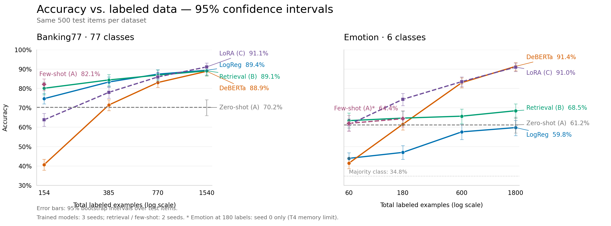

# Ticket routing with prompting, retrieval, and fine-tuning

This project compares ways to classify short messages when labeled training data is limited. It uses Banking77 and Emotion to study how accuracy changes with the label budget, when fine-tuning outperforms prompting, and whether faster inference can recover the time spent training a LoRA adapter.

It is an experimental benchmark. It does not include a production ticket-routing service or web API.

## Methods

| Method | How it works |
|---|---|
| BGE + logistic regression | Fits a classifier on frozen `BAAI/bge-small-en-v1.5` embeddings |
| DeBERTa | Fine-tunes `microsoft/deberta-v3-base` for classification |
| A: zero-shot | Gives Qwen the message and the allowed category names |
| A: fixed few-shot | Adds the same labeled demonstrations to every request |
| B: retrieval prompting | Selects ten nearby labeled examples using BGE embeddings, then prompts Qwen |
| C: LoRA | Trains adapters on Qwen and generates the category from the message |

A, B, and C use `unsloth/Qwen3.5-4B`. Retrieval supplies labeled demonstrations for classification; it is not document-based question answering. LoRA uses a 16-bit base model, rank 16, alpha 32, and completion-only loss. It is not 4-bit QLoRA.

## Data and evaluation

| Dataset | Classes | Training examples per class | Total training examples |
|---|---:|---|---|
| Banking77 | 77 | 2, 5, 10, 20 | 154, 385, 770, 1,540 |
| Emotion | 6 | 10, 30, 100, 300 | 60, 180, 600, 1,800 |

Training subsets use seeds 0, 1, and 2. Smaller budgets are nested inside larger budgets for the same seed. The pipeline removes normalized exact overlaps and filters training examples flagged as near-duplicates of the saved test set using BGE cosine similarity of at least 0.98. Saved splits have SHA-256 checksums.

Each dataset has 1,000 saved test messages. All headline comparisons use the same first 500 messages in the same order. Classifier files contain 1,000 predictions; generative files contain 500. Training-label budgets exclude the additional labeled dev data used for model selection.

Trained classifiers and LoRA have three seeds. Retrieval has two. Zero-shot has one run per dataset. Few-shot was measured at Banking77 2/class and Emotion 10/class and 30/class. Emotion 30/class has only seed 0 because seed 1 ran out of T4 memory.

Generated answers must contain exactly one `category` key with an allowed label. Invalid outputs count as incorrect. Accuracy is reported for both datasets, with macro-F1 also reported for imbalanced Emotion.

## Results

Values below are mean accuracy percentages on the 500 headline test messages.

| Dataset | Training labels | BGE + LogReg | DeBERTa | Retrieval B | LoRA C |
|---|---:|---:|---:|---:|---:|
| Banking77 | 154 | 74.7 | 40.7 | 80.1 | 63.8 |
| Banking77 | 385 | 83.3 | 71.5 | 84.4 | 78.0 |
| Banking77 | 770 | 87.4 | 83.1 | 86.9 | 85.9 |
| Banking77 | 1,540 | 89.4 | 88.9 | 89.1 | 91.1 |
| Emotion | 60 | 43.9 | 41.5 | 63.4 | 61.3 |
| Emotion | 180 | 47.0 | 61.5 | 64.7 | 74.4 |
| Emotion | 600 | 57.6 | 83.0 | 65.7 | 83.5 |
| Emotion | 1,800 | 59.8 | 91.4 | 68.5 | 91.0 |

Zero-shot reaches 70.2% on Banking77 and 61.2% on Emotion. Fixed few-shot reaches 82.1% on Banking77 at 154 labels, and 62.0% and 64.4% on Emotion at 60 and 180 labels respectively.



The predefined crossover rule requires the fine-tuned model's lower 95% accuracy bound to exceed the best available prompting mean at the matching budget. LoRA first passes on Emotion at 180 training labels; DeBERTa first passes at 600. Neither passes on Banking77 within the tested budgets. LoRA has the highest Banking77 mean at the largest budget, but its lower bound narrowly misses the rule.

Intervals use 2,000 bootstrap resamples of test messages, with observed training seeds held fixed. Paired difference intervals are reported separately. These are pointwise intervals, without multiple-comparison or comparator-selection correction. The first passing budget is a finding on the tested grid, not a universal label requirement.

## Inference speed

Timings use 200 fixed dev messages and five warmup calls. Median latency measures one request at a time; throughput measures batches of eight. GPU runs use a Tesla T4, while BGE + LogReg runs on CPU. Retrieval includes fresh CPU query embedding and neighbor selection. Response-cache hits, model loading, and training are excluded from inference timing.

| Dataset | Method | Device | Median latency | Throughput |
|---|---|---|---:|---:|
| Banking77 | BGE + LogReg | CPU | 36.5 ms | 58.47 req/s |
| Banking77 | DeBERTa | T4 | 27.8 ms | 273.38 req/s |
| Banking77 | Retrieval B | T4 | 1,115.9 ms | 1.24 req/s |
| Banking77 | LoRA C | T4 | 582.1 ms | 7.16 req/s |
| Emotion | BGE + LogReg | CPU | 38.2 ms | 44.62 req/s |
| Emotion | DeBERTa | T4 | 28.3 ms | 267.31 req/s |
| Emotion | Retrieval B | T4 | 679.3 ms | 2.31 req/s |
| Emotion | LoRA C | T4 | 349.3 ms | 10.50 req/s |

These are largest-budget measurements. LoRA roughly halves retrieval's median latency, but DeBERTa is much faster and has competitive Emotion accuracy. CPU and T4 results represent different hardware options. DeBERTa timing uses recreated checkpoints with the frozen recipe, paired with the original multi-seed accuracy results; those checkpoints were not separately rescored.

Using measured batch throughput, the estimated recovery of one final LoRA adapter's training time is 1,528 requests on Banking77 and 3,613 on Emotion:

```text
requests = LoRA training seconds / (1 / retrieval throughput - 1 / LoRA throughput)
```

This assumes sustained measured throughput and proportional compute allocation. It excludes labeling, tuning, retries, setup, idle hosting, and engineering. It estimates compute-time amortization, not measured financial savings.

## Setup

To analyze saved results and run tests, use Python 3.11 or newer in a virtual environment:

```bash
python -m venv .venv
```

Activate it with `.venv\Scripts\Activate.ps1` on Windows PowerShell or `source .venv/bin/activate` on Linux, then install:

```bash
python -m pip install -r requirements.txt
```

The analysis requirements use the versions validated locally. They do not install the model-training stack.

For training or fresh model inference, use a separate Linux/Colab CUDA environment. The recorded GPU stack used PyTorch 2.11.0+cu130, Transformers 5.17.0, Unsloth 2026.10.10, and TRL 1.15.0. Install the matching CUDA build of PyTorch, then the optional dependencies:

```bash
python -m pip install torch==2.11.0 --index-url https://download.pytorch.org/whl/cu130
python -m pip install -r requirements-gpu.txt
```

The optional file captures recorded model-package versions, but supporting dependencies were not fully version-recorded. It is not a complete environment lock or a verified fresh-install recipe. CUDA, driver, and package compatibility still need checking in the target runtime. Import Unsloth before Transformers when running Qwen jobs. Prompting's response-cache path defaults to `/content/llm_cache.sqlite` in `config.py`; adjust it outside Colab.

## Reproduce the analysis

The repository includes 95 prediction CSVs and 13 timing JSONs. The following commands regenerate tables and figures from those saved artifacts without downloading or training models:

```bash
python summarize_benchmarks.py
python break_even.py
python analyze_results.py
python error_analysis.py
python plot_benchmarks.py
python make_plots.py
python -m pytest tests -q
```

Run them from the repository root in this order. `plot_benchmarks.py` needs the tables produced by `break_even.py`. Error-review annotations are supplied in `analysis/error_annotations.csv`; they are read rather than automatically recreated. The existing suite contains 15 tests covering scoring, split separation, nested budgets, and retrieval checks.

## Run new experiments

`python data.py` builds missing dataset splits and skips existing ones. Model experiment modules expose Python functions rather than a complete command-line grid runner. For example:

```python
import baselines

baselines.run_logreg("banking77")
baselines.run_deberta("banking77")
```

For Qwen prompting in the GPU environment:

```python
import unsloth
import prompting

prompting.load_model()
cache = prompting.Cache()
prompting.run_A("banking77", cache)
prompting.run_A("banking77", cache, budget=2, seed=0)
prompting.run_B("banking77", cache, budget=20, seed=0)
```

For LoRA, run training and evaluation in separate processes to release training allocations:

```python
import unsloth
import finetune

finetune.train_run("banking77", seed=0, budget=20)
# In a fresh process with the same imports:
finetune.test_run("banking77", seed=0, budget=20)
```

These examples run individual configurations, not the full grid. Runners generally skip existing output files. Preserve the frozen results and use a separate checkout when changing experiment settings.

Benchmark entry points include:

```bash
python benchmark.py banking77 B
python benchmark.py banking77 C
python benchmark.py banking77 A_zero
python benchmark.py banking77 A_fewshot 2
python benchmark_logreg.py banking77
python benchmark_deberta.py banking77
```

GPU timing scripts require a T4. LoRA timing needs a final adapter at `adapters/<dataset>/b<budget>_s0/`, including `training_stats.json`. DeBERTa timing needs a checkpoint at `adapters/deberta/<dataset>/`. `baselines.train_deberta()` accepts `save_dir` to save a checkpoint; the normal baseline grid does not save weights. Checkpoints are excluded from Git and no checkpoint download package is supplied here.

## Repository layout

| Location | Contents |
|---|---|
| `config.py`, `data.py` | Experiment settings and saved-split construction |
| `evaluate.py` | Output validation, metrics, and bootstrap calculations |
| `baselines.py` | BGE embeddings, logistic regression, and DeBERTa |
| `prompts.py`, `prompting.py`, `retrieval.py` | Prompt construction, cached generation, and example retrieval |
| `finetune.py` | LoRA training and evaluation |
| `benchmark*.py` | Inference timing |
| `analyze_results.py`, `error_analysis.py` | Statistical comparisons and error analysis |
| `summarize_benchmarks.py`, `break_even.py` | Timing summaries and training-time amortization |
| `make_plots.py`, `plot_benchmarks.py` | Learning curves and benchmark figures |
| `splits/`, `embeddings/` | Saved inputs, metadata, checksums, and embedding arrays |
| `results/`, `benchmarks/`, `analysis/` | Predictions, timings, derived tables, figures, and notes |
| `tests/` | Evaluation, data, and retrieval tests |
| `check.py` | Small helper for preparing selected embedding caches |

For detailed assumptions, see [statistical notes](analysis/statistics_notes.md), [error-analysis notes](analysis/error_analysis_notes.md), and [compute-time notes](benchmarks/analysis_notes.md).

## Limits

The study covers two public English short-text datasets, not private production tickets. Public benchmark exposure during pretraining is unknown. Training budgets exclude dev labels, seed counts differ by method, and 500 headline messages provide limited support for individual Banking77 classes.

A/B receive category lists at inference, while C learns category spellings during training. Prompt lengths, output lengths, and training schedules also differ. This compares complete methods rather than isolating one architectural change.

Timing comes from single sessions rather than repeated production workloads. Few-shot uses batch one, and prefill/decode profiling was not performed. The 50 qualitative error annotations are AI-assisted exploratory judgments with reference labels visible, not a blinded annotation study.

Saved split checksums protect the existing inputs, but model and dataset downloads are not pinned to immutable revisions. Embedding-cache filenames also do not include model or data hashes. Full training reproduction requires the GPU environment and external checkpoints in addition to this repository.
